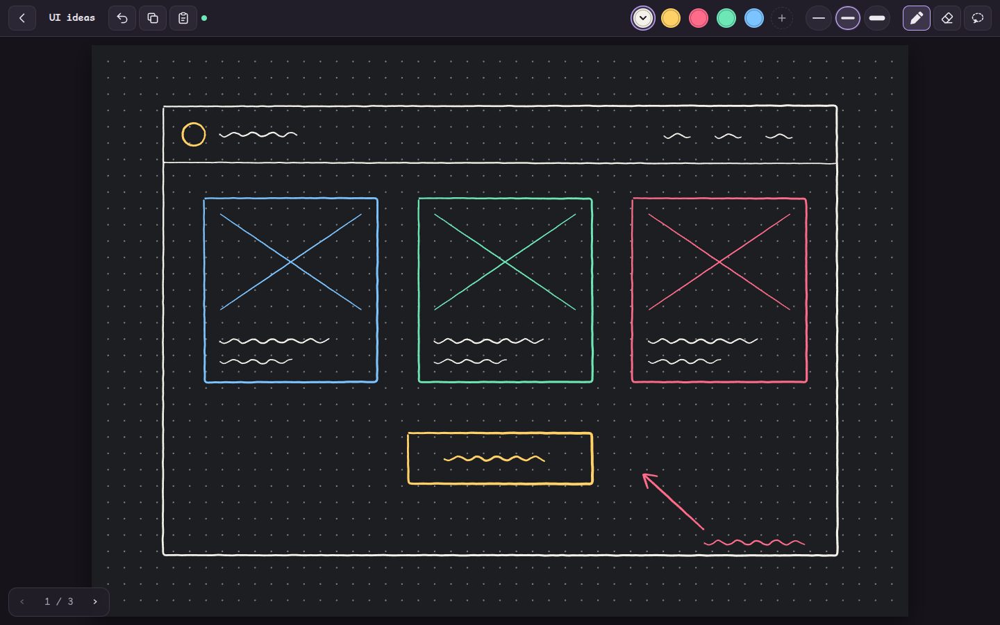

# Inkbridge

Inkbridge is a sketchpad that runs in the browser on an iPad and on a computer at the same time. Both devices show the same page, and ink appears on the other device while you draw it. Copy on any device puts the page on the computer's clipboard as a PNG image, ready to paste into a prompt. Paste brings an image or text onto the page, where every device sees it and you can draw on it.

The project exists to make one path fast: sketch on the iPad with the Pencil, then paste that sketch on the computer.



The project page, with screenshots and a short guide, is at https://motionharvest.github.io/inkbridge/.

## What it does

A space holds your notebooks. Each space has a six-digit code, and every device that enters the code sees the same notebooks.

Pressing and holding a notebook cover in the notebook list starts editing. Each cover then shows a minus button. A tap on a minus button asks for confirmation, then removes the notebook and every page in it. Done, `Esc`, or a tap on a cover ends editing. The pencil next to a notebook's name renames it.

A notebook holds pages. Swipe a finger from right to left to go to the next page. Swipe from left to right to go back.

A tap on the page number in the bottom left corner opens the page grid, a preview of every page in the notebook. A tap on a preview opens that page. Pressing and holding a preview starts editing: each page shows a minus button in its top left corner, and the pages after a removed page move over to close the gap. Done, `Esc`, or a tap on a preview ends editing. A notebook always keeps at least one page. The other devices open and close the page grid along with you.

On the last page, a swipe to the left pulls against resistance, and a New page indicator slides in from the right edge. Its ring fills as the finger travels. When the ring closes, the indicator fills with color. Lifting the finger then adds a new page with the same paper as the page before it. Lifting the finger before the ring closes springs the page back and adds nothing.

Each page has paper, ink, and a fixed size of 1600 by 1120 units. New notebooks use Graphite paper: a near-black gray (`#1d1e21`) with a mid-gray dot grid (`#7d7f85`). A new page takes the paper of the page before it, so pages made before Graphite became the only paper keep their older paper.

The toolbar fits on one line on a small iPad in landscape. Its left side holds icon buttons: back to the notebook list, the notebook name, Undo, Copy, and Paste, then a dot that is green while the device is online. The toolbar keeps the drawing controls at its right edge, where a right hand reaches them. From left to right they are the color slots, a plus button, three size slots, the Pen, the Eraser, and the Lasso. The page number and the previous and next page arrows sit in the bottom left corner of the page area.

A slot holds one value and keeps it, so the toolbar becomes your own palette. A tap on a slot selects it.

The size slots belong to the selected tool. The Pen has three line widths and the Eraser has three circle sizes, and each tool remembers its own. Each size slot previews its size: a short horizontal line at the line width, in the toolbar's light text color, for the Pen, and the eraser circle, a dark fill with a light gray outline, for the Eraser. A tap on the selected size slot opens a slider with five tick marks that changes that slot's size.

The color slots show while the Pen is selected. The selected color slot shows a chevron. A tap on it opens the color picker under the slot. Its grid holds a palette of nineteen colors in rows of five, grays first. A tap on a palette color selects it, and the toolbar slot takes that color. A second tap on the selected color opens a full color picker below the grid: a square for saturation and brightness, a preview circle, a hue slider, and red, green, and blue fields that a button switches to one hex field. A change in the full picker recolors both that palette color and the toolbar slot, so the whole palette can be customized. The rainbow dot at the end of the grid opens or closes the full picker for the selected color. The palette is saved on each device. The full picker is built into Inkbridge, so it opens at once on the iPad; while a value changes, the swatch repaints once per frame, and the color is saved when a drag ends or a field is committed. The number fields ignore the Apple Pencil and become editable only when a finger or a mouse taps them, so iPadOS Scribble, the Pencil's handwriting input, never appears in the picker. A tap outside the picker or `Esc` closes it. The plus button adds a color slot, up to twelve.

The Eraser removes only the ink inside a small circle. A ring shows the circle at the pointer while the Eraser is on. A pass through the middle of a line splits it into two lines, and the rest of the line stays.

Undo reverses this device's last step on the current page. A step is one drawn line or one eraser pass, so Undo after an eraser pass restores every line that pass cut.

Every device follows the others, in both directions. The space is always on one view: the notebook list, one page, or a notebook's page grid. When any device opens a page, goes back to the notebook list, or creates a notebook and enters it, every other device does the same. A device that joins or reconnects starts on the view the space is on. The computer therefore shows what you see on the iPad without any input.

The Lasso tool selects by drawing a freehand loop around ink and pasted items. A line is selected when at least half of it is inside the loop. A pasted item is selected when its center is inside. Pressing inside the loop and dragging, with the Pencil or the mouse, moves the selection, and every device sees it move. A tap outside the loop, with the Pencil, the mouse, or a finger, clears the selection; the next press starts a new loop. Pressing and holding inside the loop opens a menu with Copy and Remove selection. Copy does what the toolbar's Copy does. Remove selection removes the selected ink and items at once, with no confirmation. While a selection exists, Copy copies the rectangle around the loop on plain paper color, without the dot grid, at twice page resolution so a small region still pastes as a usable image. A tap without a drag, `Esc`, a page change, or another tool clears the selection. The loop belongs to the device that drew it and does not sync. Undo after a move moves the selection back, and Undo after Remove selection puts the removed ink and items back.

Paste puts an image or a block of text on the page. A pasted item sits under the ink, so you can draw on a pasted picture and copy the result back out. `Ctrl+V` or `⌘V` pastes the clipboard of the device you press it on. The Paste button in the toolbar pastes the computer's clipboard, read by the server, so the iPad can paste what you copied on the computer. An image keeps its pixel size, shrinks to fit the part of the page on screen, and lands in the middle of it. Text takes the selected pen color and wraps at 900 page units. A second paste onto the same spot moves down and to the right. Undo removes a paste.

## Run it

The quickest setup is to give this prompt to a coding agent on your computer, such as Claude Code. The agent installs Inkbridge, checks it, starts it, and tells you which address to open on your iPad.

```text
Set up Inkbridge on this computer for me. Inkbridge is a sketchpad server from https://github.com/motionharvest/inkbridge that lets my iPad and this computer share drawings, and puts copied drawings on this computer's clipboard.

1. Check that Node.js 20 or later is installed. If it is not, tell me, and install the current LTS version once I agree.
2. Clone https://github.com/motionharvest/inkbridge.git into ~/inkbridge, unless I name another folder.
3. In that folder, run npm install, then npm test. Confirm that every test passes.
4. Read the README, especially "How Copy works". Check that the clipboard tool it names for this operating system is installed. Tell me what is missing before you install anything.
5. On Linux, ask me whether Inkbridge should start with the computer. If yes, run npm run install-service. If no, or on another system, run npm start and leave it running.
6. Tell me the address to open on this computer and the address to open on my iPad. The server prints both when it starts. The iPad must be on the same network.
7. In a few sentences, tell me how to pair the iPad with this computer and how to copy a drawing.
```

To set it up by hand: Inkbridge needs Node.js 20 or later.

```bash
npm install
npm start
```

The server prints two kinds of address. Open the `localhost` address on the computer. Open one of the "Other devices" addresses on the iPad. The iPad and the computer must be on the same network.

On the first device, choose **Start a new space**. The library shows the space code in its top right corner. On the second device, type that code and choose **Join**.

Each device remembers its space and rejoins it every time the app opens. The code is kept in the browser's local storage and in the address, as `?space=123456`. Add Inkbridge to the iPad Home Screen after joining, so the icon keeps that address and opens straight into the space. **Leave** in the notebook list is the only action that forgets the space.

To keep the server running all the time on Linux, run `npm run install-service`. The script writes a systemd user service, `~/.config/systemd/user/inkbridge.service`, enables it, starts it, and turns on lingering so the service starts at boot, before anyone logs in. The service restarts the server if it stops. It runs the Node binary that ran the script, so run the script again after removing that Node version. Copy and Paste reach the clipboard once the desktop session is up. `systemctl --user status inkbridge` shows the service, `journalctl --user -u inkbridge` shows its log, and `npm run uninstall-service` removes it. Stop the service before running `npm run dev`, because both use port 5180.

To run the server with automatic restart on file changes, use `npm run dev`. To change the port, set `PORT`, for example `PORT=8080 npm start`.

## Input

| Input | Action |
| --- | --- |
| Apple Pencil or mouse | Draw |
| One finger, swipe right to left | Next page; on the last page, a full pull adds a page |
| One finger, swipe left to right | Previous page |
| Two fingers, double tap | Undo once |
| Two fingers, pinch | Zoom in or out, up to six times |
| One or two fingers on a zoomed page | Move the page |
| Ctrl with the scroll wheel, or a trackpad pinch | Zoom on a computer |
| `Ctrl+=`, `Ctrl+-`, `Ctrl+0` | Zoom in, zoom out, show the whole page |
| `→` or `Page Down` | Next page, or a new page at the end |
| `←` or `Page Up` | Previous page |
| `Ctrl+C` or `⌘C`, or the Copy button | Copy the page as a PNG to the computer's clipboard |
| `Ctrl+V` or `⌘V` | Paste this device's clipboard onto the page |
| The Paste button | Paste the computer's clipboard onto the page |
| `E` | Switch between the Pen and the Eraser |
| `S` | Switch between the Pen and the Lasso |
| `1`, `2`, `3` | Select a size slot |
| `[` and `]` | Make the selected size slot smaller or larger |
| `Ctrl+Z` or `⌘Z` | Undo |
| `Esc` | Clear the selection, or go back to the notebook list |

A finger never draws. This rule keeps a resting palm from leaving marks, and it frees fingers for swipes and zoom. Zoom belongs to each device and resets when the page changes. A touch within half a second of Pencil input, or while the Pencil hovers above the glass, is ignored for the same reason. A finger must move 12 pixels before it moves or zooms a page, so a resting palm that only shifts a little leaves the view alone. When the Pencil touches down while fingers are on the glass, the view returns to where it was when the first of those fingers landed, because those fingers were most likely a palm.

On the iPad, Safari's **Share → Add to Home Screen** opens Inkbridge full screen, without the browser's address bar.

## How Copy works

The server runs on the computer, so the server can reach the computer's clipboard. Copy renders the page as a 1600 by 1120 PNG on the device where you press it and sends the image to the server. The server puts the image on the computer's clipboard with a small GTK helper, `server/clipboard-owner.py`, on Linux with X11, `wl-copy` on Linux with Wayland, `osascript` on macOS, or PowerShell on Windows. The computer needs no Inkbridge tab open for this.

The other devices in the space show a short notice that a page went to the computer's clipboard. A device whose browser allows clipboard writes, such as the computer's own browser on `localhost`, also copies the image to its own clipboard. When neither clipboard takes the image, the page downloads as a PNG file.

## How Paste works

A pasted image travels to the server once, over Socket.IO. The server stores it in `data/assets/`, named by a hash of its bytes, and answers with that name. The device then adds the item to the page with an op that carries only the name and the item's position and size. Every device loads the image from `/assets/<name>`. An image larger than 10 MB is first re-encoded on the device as a JPEG no larger than 3200 pixels on its longest side.

The Paste button asks the server to read the computer's clipboard with `xclip` on X11 or `wl-paste` on Wayland. An image on the clipboard wins over text, because the clipboard that Copy fills also offers an empty text.

## How sync works

Every change is an op: a small JSON message such as "start a stroke", "add these points", or "add a page". The file `public/js/shared/ops.js` defines every op in one function, `applyOp`.

A device applies each op to its own copy of the space, then sends the op over Socket.IO. The server applies the same `applyOp` to its copy and relays the op to the other devices in the space. The browser and the server import the same file, so they cannot disagree about what an op means.

Pen input is smoothed before it becomes part of a line. Samples closer than 1.5 page units to the last kept point are dropped, and each kept point becomes the average of the last three kept points, so small jitters in the hand or the sensor even out. The line still ends at the exact point where the pen lifted. Every device stores the smoothed points, so a line looks the same everywhere. While you draw, new points appear on your screen immediately. They go to the server once per animation frame, so a fast Pencil sends about sixty messages per second, not one per sample.

The server keeps each space in memory and writes it to `data/<code>.json` shortly after each change. A device that joins or reconnects receives the whole space from the server.

## How offline works

Each device keeps a copy of its space in IndexedDB, saved at most twice a second and whenever the page is hidden. The app starts from that copy, so the notebook list and every page show at once, and drawing, erasing, the Lasso, text paste, page and notebook changes, and Undo all work with no server.

A change made while the server cannot be reached waits in the device's outbox. The outbox is saved with the space, so it survives closing the app. Each change carries a number from the device's own sequence. The server confirms a change after applying it, and the device then drops it from the outbox. The server also remembers the highest number it has applied for each device, and saves that number with the space. A device that sends a change twice because a confirmation was lost with the connection therefore has it applied once.

When the device reconnects, it joins the space, and the server answers with its copy and the highest number it has applied for that device. The device drops the changes up to that number, applies the rest on top of the server's copy, and sends them. The other devices receive them as they arrive. A change that no longer applies, such as an edit to a page another device removed, is confirmed and ignored on both sides.

The app itself is kept on the device by a service worker, a script the browser runs beside the page that can answer the page's requests for files. Each time the app opens, the worker asks the server for the app's files and saves them. When the server does not answer within two and a half seconds, the worker opens the saved files, so a closed app opens with no server and the saved space appears. Pasted images the device has shown are saved the same way. An app that is still open when the connection drops keeps working whether or not the worker runs.

A browser runs a service worker only for a page served over HTTPS or from `localhost`. An iPad that opens Inkbridge at a plain `http://` network address therefore cannot open a closed app offline; it keeps working offline only while the app stays open.

```
public/
  index.html, style.css     the three screens: pair, notebook list, page
  js/app.js                 state, screens, Socket.IO wiring, copy
  js/board.js               the page view, zoom, Pencil and finger input, page slides
  js/render.js              paper, pasted items, ink, and PNG rendering
  js/erase.js               clips lines against the eraser circle
  js/lasso.js               what a lasso loop contains
  js/smooth.js              smooths pen input into stroke points
  js/colorpicker.js         the full color picker and its color math
  js/local.js               this device's saved copy of the space, in IndexedDB
  js/outbox.js              numbered changes waiting for the server
  sw.js                     the service worker that keeps the app on the device
  js/shared/ops.js          the op definitions, shared with the server
server/
  index.js                  Express static files and Socket.IO rooms
  store.js                  in-memory spaces, saved to data/
  assets.js                 pasted images, saved to data/assets/
  clipboard.js              reads and writes the computer's clipboard
test/                       op tests and a two-client sync test
```

## Tests

```bash
npm test
```

The tests cover each op and run two Socket.IO clients against a real server. The two clients create a space, join it, relay a notebook and a page view, and confirm that the space is saved to disk.

## Current limits

These statements describe version 0.1.0.

The server has no authentication. Anyone on the same network who knows a space code can open that space. Run it on a network you trust.

Copy reaches the clipboard of the one computer that runs the server. A second computer in the same space does not receive the image on its clipboard. The iPad's own clipboard does not receive it either, because the iPad loads the app over plain HTTP, and browsers allow clipboard writes only on secure pages.

Before the image reaches the clipboard, the server keeps only the PNG chunks that hold the picture and drops metadata. Safari on the iPad adds `eXIf` and `sRGB` chunks to every canvas it saves, so without this step a copy from the iPad differs from a copy made on the computer. On X11 the helper offers the PNG bytes as `image/png` and an empty string as text. An app that asks for an image receives the picture. A terminal's paste key asks for text, receives the empty string, and sends an empty paste. A terminal multiplexer such as herdr reads that empty paste as the signal to fetch the image, the same way it handles a screenshot tool's image. Without Python's GTK bindings the server falls back to `xclip`, which also hands the PNG bytes to apps that ask for text. The Linux path is verified with the GTK helper on X11. The macOS, Windows, and Wayland paths are written but not yet run.

Verified on a Linux desktop in Brave: creating a space, creating a notebook, drawing with a mouse, adding a page with `→`, copying a page to the clipboard as a 1600 by 1120 PNG, cutting a gap in one line with the Eraser, restoring the line with Undo, adding and editing color slots, and zooming with `Ctrl+=` while drawing stays under the pointer. On the iPad, the user drew with the Pencil and saw the ink sync to the computer. Pinch zoom on the iPad is not yet tested on a device.

Pasting from the computer's clipboard works on Linux only. On macOS and Windows the Paste button reports that it is not supported, and `Ctrl+V` on the computer's own browser still works.

A pasted item can be moved or removed with the Lasso but cannot be resized or erased. A selection cannot be resized or rotated. Removing a page or notebook leaves its pasted images in `data/assets/`.

Verified for Paste on the Linux desktop in Brave: the Paste button placed the image from the computer's clipboard on the page, ink drew over it, `Ctrl+V` pasted the same image, and both items reached the server's saved space. Pasting text and pasting on the iPad are not yet tested. The Lasso is verified with the mouse on the desktop: a loop selected two images and a line, a drag moved them, the server saved the new positions, and Undo moved them back. A tap outside the loop cleared it, a long press inside opened Remove selection, Remove took both images off the page, and Undo put them back. The Lasso is not yet tested with the Pencil or a finger.

A device that is offline cannot create a space, join one, copy to the computer's clipboard, paste from it, or paste an image from its own clipboard, because each of these needs the server. Images already on a page show offline only if the device has displayed them before.

There is no redo and no page reordering.
